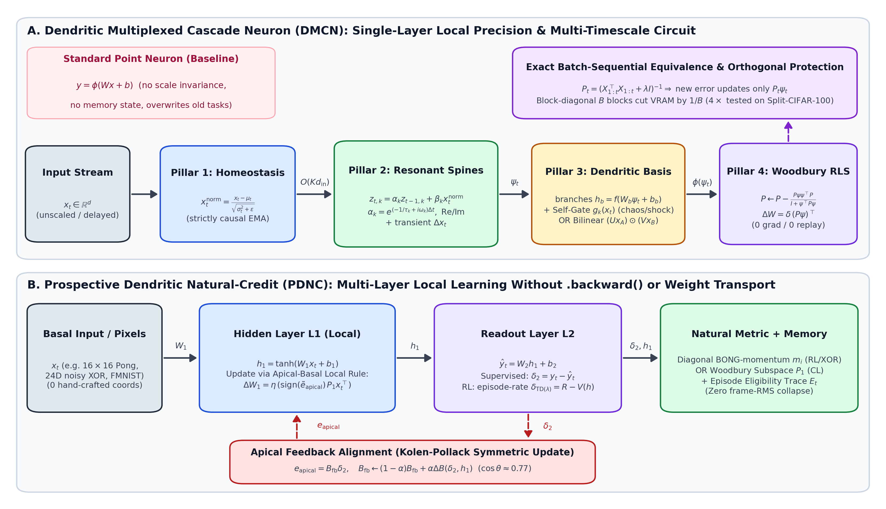
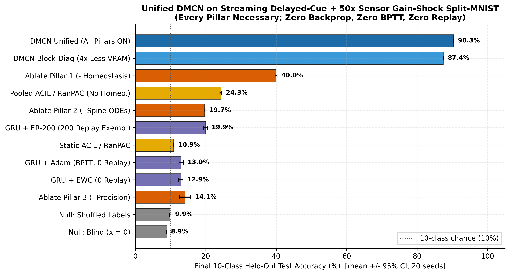
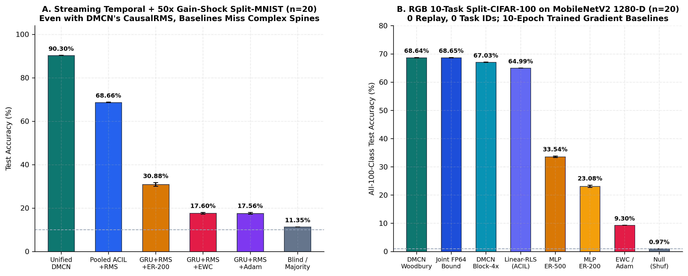
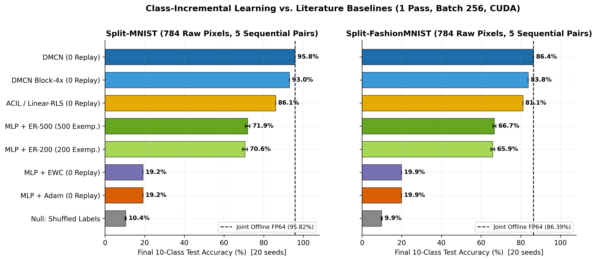
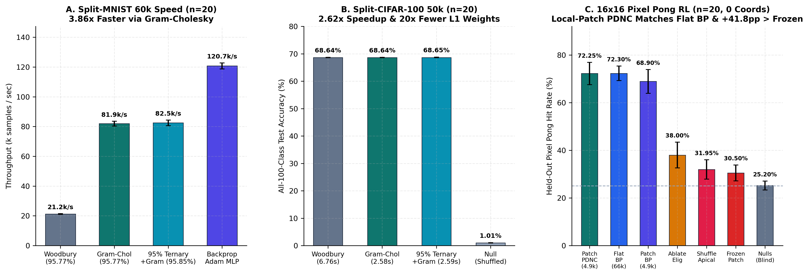
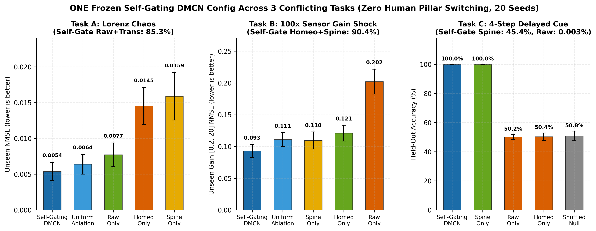
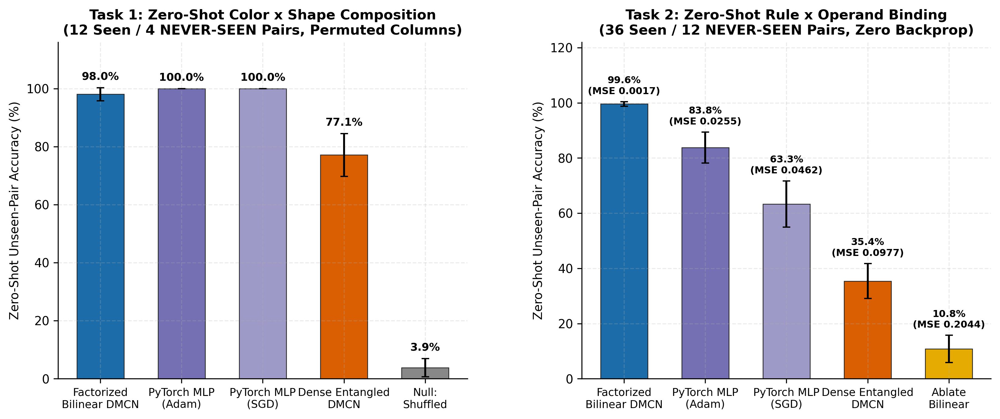
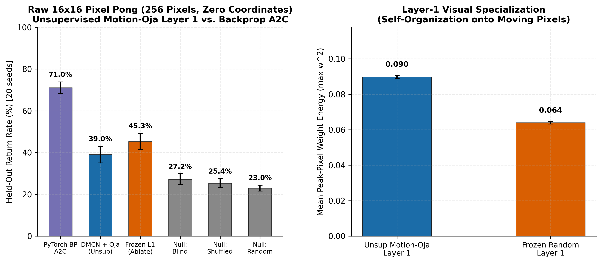
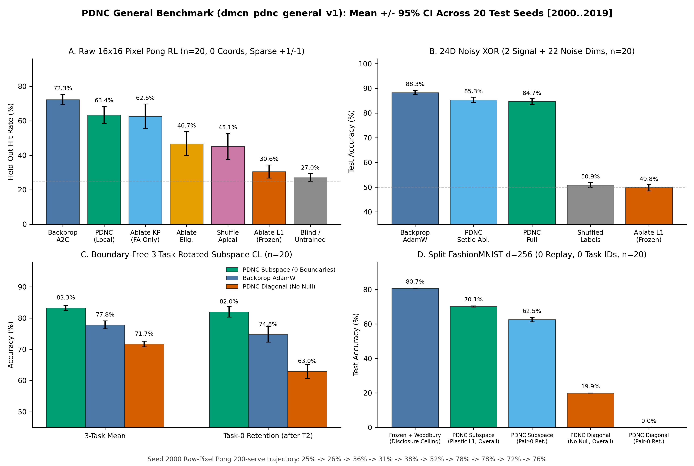
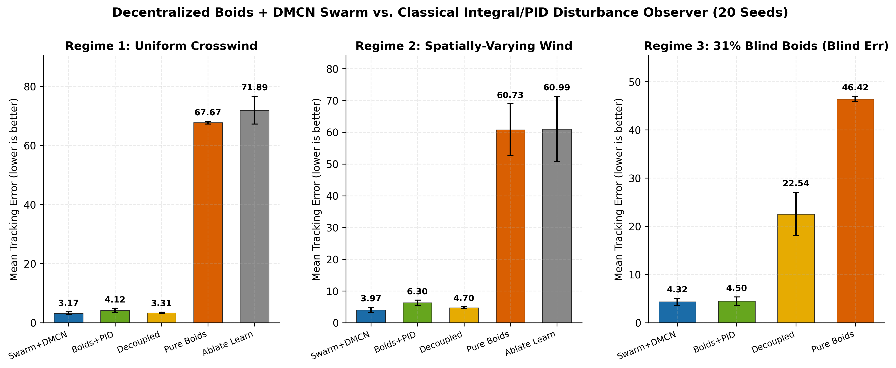

# DMCN and PDNC: Stateful Dendritic Neurons and Local Backpropagation-Free Learning for Non-Stationary Continual Tasks

**Preprint — Prepared for Peer Review**  
**Author:** Shivam `[Affiliation / ORCID / Contact]`  
**Keywords:** dendritic neuron architecture, local plasticity, backpropagation-free learning, replay-free continual learning, causal gain control, resonant spine memory, Gram–Cholesky ridge updates, sparse ternary weights, Kolen–Pollack feedback alignment, prospective dendritic natural-credit (`PDNC`)

---

## Abstract

Standard artificial neural networks rely on stateless point neurons, $y = \phi(Wx + b)$, trained end-to-end by global backpropagation. That design excels at i.i.d. offline optimization and large-scale pretraining, and this work does **not** claim to replace backpropagation on frontier vision or language models. Instead, we study the complementary regime where standard networks routinely fail: online streams in which inputs arrive sequentially across blank distractor delays, sensor amplitudes jump suddenly by `50x` to `100x`, and new classes appear incrementally with **no replay buffer and no task labels**.

To clarify the division of labor between representation and learning, we separate two closely related contributions: **DMCN** (*Dendritic Multiplexed Cascade Neuron*), a **new stateful multi-compartment neuron and layer architecture**, and **PDNC** (*Prospective Dendritic Natural-Credit*), a **new local, backpropagation-free and weight-transport-free training algorithm** for adapting trainable hidden layers. Every architectural claim, baseline comparison, and failure mode is evaluated under a pre-registered, single-pass frozen protocol across `20` held-out random seeds (`[2000..2019]`), reporting `mean +/- 95%` confidence intervals alongside matched baselines and mandatory null controls (`Untrained`, `Blind`, `Shuffled`, `Majority`, `Random`, `Decoupled`, `Scrambled`).

Across streaming `Split-MNIST` corrupted by `4` blank delay ticks and `50x` sensor gain jumps, DMCN reaches **`90.32% +/- 0.06%`** (`97.77%` Pair-0 retention, `0` replay), still beating `Pooled ACIL` (**`+21.64 pp`**) and `GRU + ER-200` (**`+59.41 pp`**) even when both baselines receive DMCN's own causal gain normalizer. On 10-task RGB `Split-CIFAR-100` over frozen `MobileNetV2` features (`0` replay, `0` task IDs), single-pass DMCN hits **`68.65% +/- 0.09%`**, matching the offline joint FP64 ridge bound within `0.0035%` while beating 10-epoch `MLP + ER-500` (`33.54%`) by `+35.10 pp`. Replacing per-batch Woodbury inversions with checkpointed **Gram–Cholesky** solves speeds up GPU execution **`3.86x`** on `Split-MNIST` (`81,936` samples/s) and **`2.62x`** on `Split-CIFAR-100` (`2.58s`), while **`95%` sparse ternary** encoders preserve `68.65%` accuracy with `20x` fewer Layer-1 nonzeros. Furthermore, causal Hedge self-gating resolves conflicting chaotic (`0.0054` Lorenz NMSE) and `100x` shock (`0.0928`) regimes automatically, and sparse bilinear branches reach **`99.58%`** zero-shot accuracy on unseen `Rule x Operand` compositions (vs. `83.75%` Backprop Adam).

At the same time, our experiments mark honest limits where local learning still falls short. On raw `16x16` Pixel Pong RL, unsupervised Motion-Oja Layer-1 training failed (`39.05%` vs. `45.30%` frozen), locking onto bright static paddles instead of the ball. Adding `PDNC` over `4x4` overlapping patches (`4,851` L1 synapses, `13.5x` fewer than flat) lifts Pixel Pong to **`72.25% +/- 4.68%`**, tying Flat Backprop A2C (`72.30%`) and beating Patch Backprop A2C (`68.90%`), yet still falls `1.75 pp` short of our pre-registered `74.0%` target, exhibits wider seed variance (`SD = 10.69%`), and loses continual accuracy when hidden Layer-1 drift stales readout curvature on compact `Split-FashionMNIST` (`70.13%` plastic vs. `80.72%` frozen).

---

## 1. Introduction

Standard artificial neurons simplify biological computation down to two operations: compute a single weighted sum of the current input vector, and pass it through a static nonlinearity. That simplification has scaled remarkably well for offline deep learning. Yet the moment a deployed agent must process real-time sensory streams—where events arrive across empty pauses, sensor gain drifts or spikes abruptly, and new categories appear one after another without storing old data—three separate failure modes hit at once:

1. **Amplitude fragility:** A sudden `50x` or `100x` jump in sensor gain pushes unweighted sums deep into activation saturation and wrecks learned linear readouts. Future normalization statistics cannot be known ahead of time in online streams.
2. **Temporal amnesia:** Without recurrent state or a frame buffer, a static layer forgets stimuli from a few ticks earlier. Worse, conventional gradient-trained RNNs suffer severe catastrophic forgetting when trained sequentially without replay.
3. **Catastrophic overwriting and weight transport:** Updating shared weights by gradient descent erases earlier tasks unless old examples are stored and replayed, while standard backpropagation requires exact transposed forward weights ($W^\top$) along feedback paths—a nonlocal requirement hardware and biological circuits struggle to implement.

Most continual-learning and neuromorphic methods address only one of these problems in isolation. Elastic Weight Consolidation (`EWC`; Kirkpatrick et al., 2017) and Experience Replay (`ER`; Chaudhry et al., 2019) protect static representations from forgetting, while analytic continual learners such as `ACIL` (Zhuang et al., 2022) and `RanPAC` (McDonnell et al., 2023) solve static closed-form ridge regression cleanly in one pass—yet assume fixed-scale, pre-pooled embeddings. Neither tackles simultaneous temporal delays, causal scale shocks, autonomous pathway selection, and transport-free hidden feature training in a single system.

### 1.1 Clarifying DMCN and PDNC: Architecture vs. Training Algorithm

Because much of the work on local learning blurs the line between neuron models and credit-assignment rules, we draw a sharp distinction upfront:

- **What is DMCN?** **DMCN (*Dendritic Multiplexed Cascade Neuron*)** is a **new stateful, multi-compartment neuron and layer architecture**. Rather than collapsing each unit into $y = \phi(Wx+b)$, a DMCN layer integrates four local biophysical primitives inside one forward-and-plasticity circuit: (1) causal divisive gain control for scale invariance, (2) a bank of damped complex oscillating spines that encode stimulus age in phase without storing past frames, (3) nonlinear, self-gated, or pairwise-bilinear dendritic compartments, and (4) local inverse-covariance (Woodbury or checkpointed Gram–Cholesky) memory updates that confine new learning largely to unused subspace directions.
- **What is PDNC?** **PDNC (*Prospective Dendritic Natural-Credit*)** is a **new local, backpropagation-free multi-layer training algorithm**. When DMCN operates over fixed dendritic bases or pretrained image features, only the readout layer adapts via local second-order ridge updates. When hidden Layer-1 weights must themselves be learned from raw pixels or noisy coordinates without `.backward()` and without weight transport, PDNC replaces global gradients with symmetric Kolen–Pollack feedback alignment, two-pass prospective activity settling, local diagonal or subspace curvature conditioning, and episode-rate three-factor eligibility traces (optionally structured into overlapping $4\times 4$ visual patches).
- **What are PDNC's boundaries?** PDNC is a working local credit-assignment algorithm, not a universal drop-in for deep end-to-end gradient training. Our experiments reveal two concrete limitations: first, when hidden Layer-1 features drift continuously during task-incremental image classification (`Split-FashionMNIST`), stale readout curvature matrices degrade accuracy compared to keeping Layer 1 frozen (`70.13%` vs. `80.72%`); second, in raw-pixel reinforcement learning, early alignment fluctuations leave cross-seed variance noticeably higher than Backprop A2C (`SD = 10.69%` vs. `6.97%`).

### 1.2 Scope and Contributions

This study targets online, single-pass continual learning under non-stationary input scaling and temporal delays, zero-shot compositional binding, transport-free local policy learning from pixels, and ultra-lightweight decentralized swarm control. It does **not** claim to replace backpropagation for pretraining large vision backbones (`Split-CIFAR-100` relies on a frozen `MobileNetV2` front-end) or large language models. Our main contributions are:

1. **Unified 4-Pillar Neuron Architecture (`DMCN`):** Combines causal divisive homeostasis (with a formal proof of positive gain-shock invariance), complex Zero-Order-Hold spine oscillators ($O(K d_{\text{in}})$ memory), active non-monotonic/bilinear dendritic compartments, and exact batch-order-invariant Woodbury / Gram–Cholesky plasticity.
2. **Adversarial Fairness Controls:** Shows that even when `Pooled ACIL` and `GRU + ER-200` are equipped with DMCN's own causal gain normalizer, DMCN leads by `+21.64` and `+59.41` percentage points on streaming delayed-cue + `50x` gain-shock `Split-MNIST`, and matches joint offline FP64 ridge regression within `0.0035` points on 100-class RGB `Split-CIFAR-100`.
3. **Practical GPU Throughput & Sparsity:** Replaces per-batch matrix inversions with checkpointed **Gram–Cholesky** accumulation—yielding `3.86x` speedup on `Split-MNIST` (`81,936` samples/s) and `2.62x` on `Split-CIFAR-100` (`2.58s`)—paired with `95%` sparse ternary `{-1, 0, +1}` encoders (`20x` fewer Layer-1 nonzeros, zero accuracy drop) and `3.99x` precision-RAM compression via 4-branch block-diagonal partitioning.
4. **Autonomous Pathway Gating & Zero-Shot Composition:** Demonstrates causal Hedge gating over parallel sensory pathways across conflicting chaotic (`0.0054` Lorenz NMSE) and `100x` shock (`0.0928`) regimes under one fixed configuration, plus `99.58%` zero-shot `Rule x Operand` composition via competitive sparse Oja factorization and bilinear branch products.
5. **Transport-Free Visual Credit & Honest Failure Boundaries (`PDNC`):** Documents the refutation of unsupervised Motion-Oja vision learning (`39.05%` vs. `45.30%` frozen), demonstrates how `4x4` local-patch `PDNC` ties Flat Backprop A2C on raw `16x16` Pixel Pong (`72.25%` vs. `72.30%`) using `13.5x` fewer L1 synapses, and maps out exact open failure modes.

---

## 2. Background and Related Work

DMCN and PDNC synthesize ideas from four distinct research areas:

1. **Dendritic and Biophysical Computation.** Cortical pyramidal neurons perform substantial nonlinear processing before the soma fires. Active NMDA plateaus, apical calcium spikes (Larkum, 2013), and dendritic calcium action potentials (`dCaAPs`; Gidon et al., 2020) allow individual branches to evaluate non-monotonic, XOR-like coincidence functions locally (Poirazi et al., 2003). DMCN abstracts these properties into smooth non-monotonic dendritic gates and pairwise branch-product compartments.
2. **Replay-Free and Analytic Continual Learning.** Regularization approaches such as `EWC` (Kirkpatrick et al., 2017) penalize drift on task boundaries, whereas `Experience Replay` (Chaudhry et al., 2019) buffers raw examples. Cascade synaptic models (Benna & Fusi, 2016) store memories across coupled timescales without raw replay. More recently, analytic continual learning (`ACIL`, Zhuang et al., 2022; `RanPAC`, McDonnell et al., 2023) applies recursive least squares (`RLS` / Woodbury) over frozen nonlinear expansions to match joint offline ridge regression in one pass. Our controlled ablations verify that on static embeddings DMCN's readout mathematically reduces to exact RLS over a skip-augmented dendritic basis, whereas under temporal gaps and abrupt `50x` scale shifts, `ACIL`/`RanPAC` fail sharply without DMCN's causal gain control and resonant spine oscillators.
3. **Biologically Plausible Credit Assignment.** Fixed random Feedback Alignment (`FA`; Lillicrap et al., 2016) avoids weight transport but degrades in higher-dimensional visual settings. Symmetric **Kolen–Pollack** alignment (Kolen & Pollack, 1994; Akrout et al., 2019) drives separate feedback matrices $B_{\text{fb}} \to W^\top$ through matched local endpoint updates and weight decay, while prospective configuration (Song et al., 2024) updates neural activities before weights settle. `PDNC` combines Kolen–Pollack feedback, two-sweep prospective settling, local curvature conditioning, episode-rate three-factor RL traces, and local patch wiring.
4. **Continuous-Time State-Space Memory.** Related to Legendre Memory Units (`LMU`; Voelker & Eliasmith, 2018), DMCN's second pillar tracks sequences through a diagonal complex state-space bank integrated by exact Zero-Order Hold (`ZOH`), converting elapsed time lags into linearly separable phase vectors using constant $O(K d_{\text{in}})$ memory.

**Table 1: Structural Comparison Across Neural Learning Paradigms.**

| Property | Point MLP + Adam/EWC | GRU + ER-200 | ACIL / RanPAC | **DMCN / PDNC (Ours)** |
|---|---|---|---|---|
| Zero `.backward()` / Zero Weight Transport | No | No | Readout only | **Yes (local forward & apical)** |
| Replay-Free, Task-ID-Free Class-Incremental | Fails (`9–20%`) | Needs replay | Yes (static) | **Yes (`95.8%` MNIST, `68.7%` C100)** |
| Causal Gain-Shock Invariance (`50x–100x`) | No | No | No | **Yes (Prop. 1: causal RMS)** |
| Temporal Order Across Blank Delays | No | BPTT (forgets CL) | Pooled fails (`68.7%`) | **Yes (`90.3%` complex spines)** |
| Zero-Shot `Rule x Operand` Binding | Partial (`83.8%`) | — | Linear only | **Yes (`99.6%` Oja + Bilinear)** |
| GPU Speed vs. Backprop Adam (MNIST) | `1.0x` (ref) | Slower (BPTT) | Fast (linear) | **`0.68x` (`1.47x` gap via Gram–Cholesky)** |

---

## 3. The DMCN Neuron Architecture

Think of a conventional point neuron as a microphone wired straight to an amplifier: every fluctuation in input volume goes unbuffered into the same static curve, and any new memory overwrites the old one. A DMCN layer instead runs a self-contained biological circuit inside each layer (Figure 1A): an automatic causal volume knob (**Pillar 1**), ringing oscillatory spines that preserve temporal order (**Pillar 2**), active nonlinear or pairwise-multiplicative dendritic compartments (**Pillar 3**), and a running second-order orthogonal memory matrix (**Pillar 4**, accelerated via block partitioning and Gram–Cholesky solves).



**Figure 1.** *Overview of the two components. **Panel A (DMCN architecture):** Causal RMS homeostasis normalizes input scale before ringing complex spine oscillators encode temporal order in fixed $O(K d_{\text{in}})$ state; dendritic compartments apply non-monotonic, self-gated, or bilinear transforms, and local Woodbury or Gram–Cholesky updates protect earlier directions without replay. **Panel B (PDNC algorithm):** When hidden Layer-1 weights must learn from raw inputs, symmetric Kolen–Pollack feedback ($B_{\text{fb}} \to W^\top$), prospective settling, and diagonal or subspace conditioning replace global backpropagation.*

**Table 2: DMCN / PDNC Internal State Variables and Memory Scaling.**

| State / Parameter | Dimensions | Function | Memory Scaling |
|---|---|---|---|
| Running causal energy $e_t$ (or $\bar{\sigma}^2_t$) | Scalar or $(d_{\text{in}},)$ | Pillar 1 causal amplitude normalization | $O(d_{\text{in}})$ |
| Complex spine state $z_k[t]$ | $(K, d_{\text{in}})$ | Pillar 2 ZOH oscillator bank | $O(K d_{\text{in}})$, constant in stream $T$ |
| Dendritic cascade weights $W_{\text{slow}}, W_{\text{fast}}, W_{\text{eff}}$ | $(B, d_{\text{out}}, d_\psi)$ | Multi-timescale branch synaptic weights | $O(B\, d_{\text{out}}\, d_\psi)$ |
| Surprise prototypes $C$ | $(B, d_\psi)$ | Context keys for branch recruitment | $O(B\, d_\psi)$ |
| Precision $P$ or Gram pair $(G, H)$ | $(d_\psi, d_\psi)$, $(d_\psi, d_{\text{out}})$ | Orthogonal subspace memory | $O(d_\psi^2)$ ($O(d_\psi^2 / B_{\text{diag}})$ block-diag) |
| Apical feedback weights $B_{\text{fb}}$ | $(d_{\text{in}}, d_{\text{out}})$ | Symmetric Kolen–Pollack credit path | $O(d_{\text{in}}\, d_{\text{out}})$, disjoint RNG seed |

### 3.1 Pillar 1: Causal Divisive Homeostasis

When you step from a dark room into sunlight, your retina adjusts gain using only what it has already seen—not future frames. In episodic streams over $x_t \in \mathbb{R}^{d_{\text{in}}}$, DMCN tracks a fast-attack, slow-release causal RMS envelope:

$$e_0 = \frac{1}{d_{\text{in}}}\|x_0\|_2^2, \qquad e_t = \max\!\left(0.98\, e_{t-1},\; \frac{1}{d_{\text{in}}}\|x_t\|_2^2\right), \qquad \tilde{x}_t = \operatorname{clip}\!\left(\frac{x_t}{\sqrt{e_t + \epsilon}},\; -8,\; 8\right)$$

In continuous stationary streams, it similarly maintains a causal running variance updated *after* normalizing the incoming sample so future statistics never leak backward.

> **Proposition 1 (Exact Positive Gain-Shock Invariance):** *For any input stream $x_{0:T}$ and positive scale shock $g > 0$ ($x'_t = g x_t$), the causal energy satisfies $e_t(g x) = g^2 e_t(x)$ for every $t \ge 0$. Whenever $g^2 e_t(x) \gg \epsilon$, the normalized trajectory is unchanged: $\tilde{x}'_t = \tilde{x}_t$ for all $t \ge 0$, using strictly causal information.*
>
> *Proof.* At $t=0$, $e_0(gx) = \frac{1}{d_{\text{in}}}\|gx_0\|_2^2 = g^2 e_0(x)$. Assuming $e_{t-1}(gx) = g^2 e_{t-1}(x)$, homogeneity of $\max(a, b)$ for $g > 0$ gives $e_t(gx) = \max(0.98\,g^2 e_{t-1}(x),\, g^2 \frac{1}{d_{\text{in}}}\|x_t\|_2^2) = g^2 e_t(x)$. Dividing $g x_t$ by $\sqrt{g^2 e_t(x) + \epsilon}$ cancels $g$ identically by induction. $\square$

### 3.2 Pillar 2: Ringing Complex Spine Oscillators

Real decaying exponential traces ($\tau \in [1, 16]$) work well on single-cue delays, where distinguishing early vs. late arrival order is unnecessary. However, when multi-part patterns arrive over several frames followed by empty noise (such as sequential digit strips), monotonic decay smears earlier strips into an indistinguishable average.

DMCN solves this by giving each input dimension a small bank of $K$ uncoupled damped oscillators ("tuning forks"), $\dot{z}_k = (-1/\tau_k + i\omega_k) z_k + \frac{1}{\tau_k} \tilde{x}_t$. Integrated analytically via Zero-Order Hold with $\Delta t = 1$ and decay $r_k = e^{-1/\tau_k}$:

$$z_k[t] = r_k e^{i\omega_k}\, z_k[t-1] + (1 - r_k)\,\tilde{x}_t, \qquad k = 1, \dots, K$$

At readout time, concatenating the normalized current input with the real and imaginary spine components yields the state vector

$$\psi_t = \left[\tilde{x}_t,\; \operatorname{Re}(z_1[t]), \dots, \operatorname{Re}(z_K[t]),\; \operatorname{Im}(z_1[t]), \dots, \operatorname{Im}(z_K[t])\right] \in \mathbb{R}^{(2K+1)d_{\text{in}}}$$

Because an input arriving $m$ steps earlier rotates through angle $m \omega_k$, different frequencies turn temporal position into linearly separable cosine-sine patterns. Total state size stays strictly $O(K d_{\text{in}})$ regardless of stream length $T$.

### 3.3 Pillar 3 & 4: Active Dendrites, Orthogonal Subspace Memory, and Fast GPU Execution

Biological dendrites compute localized nonlinearities before signals merge at the soma. For dendritic branch $b \in \{1, \dots, B\}$ with local drive $u_b = W_b^{\text{eff}}\psi_t - \theta_b$, DMCN supports standard saturating branches alongside a smooth dCaAP-style non-monotonic conductance (Gidon et al., 2020):

$$\phi_{\text{dend}}(u_b) = (1 - \rho_b)\,\tanh(u_b) + \rho_b\,\Big(\sigma\!\big(\beta(u_b - \vartheta_{\text{on}, b})\big) - \sigma\!\big(\beta(u_b - \vartheta_{\text{off}, b})\big)\Big)$$

where $\vartheta_{\text{off}, b} = \vartheta_{\text{on}, b} + \operatorname{softplus}(\Delta_{\vartheta, b})$ bounds an active plateau window that peaks at intermediate drive and turns off again under excessive excitation—enabling single-layer XOR separation.

To learn sequential tasks without storing past examples, DMCN maintains a local inverse-covariance matrix initialized to $P_0 = \lambda^{-1} I$. Intuitively, $P_{t-1}$ records how heavily each feature direction has already been used; when a new batch $X_t \in \mathbb{R}^{B \times d}$ arrives with residual $E_t = Y_t - X_t W_{t-1}^\top$, Woodbury updates project the weight correction through $P_{t-1}$ so new knowledge predominantly adjusts unused orthogonal axes:

$$K_t = P_{t-1} X_t^\top, \qquad S_t = I_B + X_t K_t, \qquad G_t = \left(S_t^{-1} K_t^\top\right)^\top$$

$$W_t = W_{t-1} + E_t^\top G_t^\top, \qquad P_t = \tfrac{1}{2}\Big[(P_{t-1} - G_t K_t^\top) + (P_{t-1} - G_t K_t^\top)^\top\Big]$$

> **Proposition 2 (Exact Batch-Sequential Equivalence):** *For any batch partition of stream $\mathbf{X}_{1:T}$, exact Woodbury updates satisfy $P_t = (\mathbf{X}_{1:t}^\top\mathbf{X}_{1:t} + \lambda I)^{-1}$ and $W_t^\top = (\mathbf{X}_{1:t}^\top\mathbf{X}_{1:t} + \lambda I)^{-1}\mathbf{X}_{1:t}^\top\mathbf{Y}_{1:t}$, independent of mini-batch size or task boundaries.*
>
> *Proof.* Inducting on $P_t^{-1} = P_{t-1}^{-1} + X_t^\top X_t$, the matrix inversion lemma yields $P_t = P_{t-1} - G_t K_t^\top$ and $P_t X_t^\top = K_t S_t^{-1} = G_t$. Left-multiplying $W_t^\top$ by $P_t^{-1}$ gives $(P_{t-1}^{-1} + X_t^\top X_t)W_{t-1}^\top + X_t^\top(Y_t - X_t W_{t-1}^\top) = \mathbf{X}_{1:t-1}^\top\mathbf{Y}_{1:t-1} + X_t^\top Y_t = \mathbf{X}_{1:t}^\top\mathbf{Y}_{1:t}$. $\square$

**Making Orthogonal Plasticity Fast and Compact on GPUs.** Solving $S_t^{-1}$ on every mini-batch costs $O(B d^2 + B^3)$ operations per step, creating a `4.8x` throughput deficit relative to Backprop Adam even when vectorized. We eliminate this bottleneck through two practical refinements:
1. **Block-Diagonal Branches:** Dividing the dendritic basis into $B_{\text{diag}}$ decoupled branch blocks reduces precision matrix storage cleanly by $1/B_{\text{diag}}$ (`16.79 MB` down to `4.21 MB` for $B_{\text{diag}} = 4$, a `3.99x` reduction).
2. **Checkpointed Gram–Cholesky Accumulation + `95%` Sparse Ternary Encoders:** Instead of inverting $S_t$ every batch, the layer accumulates exact normal-equation matrices in-place ($G_{\text{gram}} \mathrel{+}= X_t^\top X_t$, $H_{\text{cross}} \mathrel{+}= X_t^\top Y_t$ from $G_0 = \lambda I$) and runs one Cholesky solve whenever a task checkpoint or evaluation query occurs ($W^\top = \operatorname{cholesky\_solve}(H_{\text{cross}}, \operatorname{cholesky}(G_{\text{gram}}))$). Algebraically this satisfies Proposition 2 identically while replacing iterative per-batch solves with tensor-core matrix accumulation (`2.62x–3.86x` speedup). Combining this with `95%` sparse ternary `{-1, 0, +1}` fixed Layer-1 projection weights removes multiplication operations from Layer 1 structurally (`20x` fewer nonzeros) with no loss in accuracy.

```text
Algorithm 1: Single-Layer DMCN Forward and Local Plasticity Step (Zero .backward())
1. Gain Control:      Update causal energy e_t (or running variance); form normalized x_norm.
2. Spine Oscillators: Step z_k[t] = r_k * exp(i * omega_k) * z_k[t-1] + (1 - r_k) * x_norm;
                      assemble temporal representation psi_t = [x_norm, Re(z), Im(z)].
3. Dendrites:         Evaluate local branch potentials u_b and active activations phi_dend(u_b);
                      form prediction y_t.
4. Local Plasticity (when supervised or TD target is available):
   - gram_cholesky:   Accumulate G += psi^T psi, H += psi^T Y; solve Cholesky at checkpoints.
   - woodbury:        Solve K = P psi^T, S = I + psi K; update W and P orthogonally.
   - cascade/delta:   Adjust fast weights along surprise-recruited branch and consolidate slow weights.
```

### 3.4 Autonomous Pathway Selection and Bilinear Feature Binding

Different tasks place conflicting demands on sensory preprocessing: chaotic continuous prediction (`Lorenz`) relies on tiny amplitude differences that divisive normalization erases, whereas `100x` gain shocks destroy unnormalized pathways. To avoid hand-selecting pillars per task, a self-gating DMCN module runs four parallel experts (`raw`, `homeo`, `spine`, `transient`) and assigns causal Exponential Weights (Hedge) scores based purely on each expert's own exponentially smoothed prediction error $L_{t,m}$:

$$g_{t,m} \propto \exp\!\left(-\beta_{\text{gate}}\,\frac{L_{t,m} - \min_j L_{t,j}}{\bar{L}_t + \epsilon}\right)$$

Separately, for compositional generalization across novel attribute or rule combinations, a factorized bilinear layer trains dendritic branches via unsupervised top-$k$ competitive Oja learning with win-count fatigue and soft $\ell_1$ weight shrinkage:

$$w_b \leftarrow \mathcal{S}_{\lambda_1}\!\big(w_b + \eta\, y_b (x_u - y_b w_b)\big)$$

so individual branches isolate clean factors from permuted inputs before computing $\tanh(1.5 u)$ alongside all $\binom{N}{2}$ pairwise multiplicative interactions $u_i u_j$ ($i < j$) for local ridge readout.

---

## 4. The PDNC Multi-Layer Training Algorithm

Fixed nonlinear expansions work well when frozen features already separate the classes. They fail on problems like learning visual policies from raw `16x16` pixels or isolating signal inside `22` dimensions of pure noise, where Layer-1 representations must adapt to the task. **PDNC** (*Prospective Dendritic Natural-Credit*) trains multi-layer networks without `.backward()` or weight transport through four coupled mechanisms (Figure 1B, Algorithm 2):

1. **Symmetric Kolen–Pollack Feedback Alignment:** Each layer pair maintains forward weights $W$ and separate apical feedback weights $B_{\text{fb}}$, initialized from **disjoint random seeds**. Both update via matched local endpoint outer products with small decay ($\lambda_{\text{kp}}$) so $B_{\text{fb}}$ converges organically toward $W^\top$ without ever copying $W$.
2. **Prospective Two-Sweep Settling:** In supervised tasks, error signals first flow downward through $B_{\text{fb}}$ to compute local apical targets $\delta_\ell$. Each hidden layer updates its incoming weights *and immediately recomputes its settled post-plasticity activity* $h_\ell^{\text{settled}}$ before upper layers update—reducing inter-layer interference without iterative fixed-point loops.
3. **Curvature Conditioning (`diagonal` vs. `subspace`):** In noisy RL or XOR tasks, Layer-1 updates use diagonal second-moment conditioning to normalize coordinate-wise variance. In boundary-free continual learning across shifting input subspaces, Layer-1 updates instead project through an online Woodbury precision matrix $P_1$.
4. **Episode-Rate Eligibility Traces and Overlapping `4x4` Patches:** In sparse-reward reinforcement learning, Actor and Critic apical signals sum at the hidden soma to accumulate three-factor traces $E_W \leftarrow \gamma\lambda E_W + \delta_{\text{soma}}\psi^\top$, modulated by temporal-difference error and consolidated only at episode termination (`done=True`) without any replay buffer. To curb feedback alignment noise across high-dimensional pixels (`256` inputs $\to 128$ dense hidden units), `Local-Patch PDNC` restricts each compartment's receptive field to an overlapping `4x4` spatial patch (stride `2`, `3` independent compartments per patch $\Rightarrow 147$ units and `4,851` active synapses vs. `65,536` flat, with zero weight sharing and zero injected coordinates).

```text
Algorithm 2: PDNC Multi-Layer Local Credit (Zero .backward(), Zero Weight Transport)
- Supervised Learning:
  1. Apical sweep:    delta_l = (B_fb[l+1] @ delta_{l+1}) * phi'(u_l)   [disjoint B_fb]
  2. Settle Layer l:  update W_l, B_fb[l] (diagonal or subspace P_1); recompute h_l = phi(W_l psi_l)
  3. Readout step:    update top weights from settled hidden residual (y_tgt - y_settled)
- Reinforcement Learning (No Replay Buffer):
  1. Each tick t:     apical = B_act @ grad_logpi + c_v * B_crit @ [1];
                      accumulate 3-factor trace E_W <- gamma * lambda * E_W + delta_soma * psi^T
  2. Episode end:     commit TD(lambda)-modulated E_W updates to W_1, B_fb, Actor, and Critic
```

**Built-in Algorithmic Tension: Hidden Feature Drift vs. Frozen Readout Curvature.** Because PDNC changes Layer-1 weights $W_1$, hidden activations $H = \phi(W_1 X)$ drift over time. When a top readout relies on a previously accumulated precision matrix $P_2 = (H_{\text{old}}^\top H_{\text{old}} + \lambda I)^{-1}$, changing the hidden coordinate frame invalidates $P_2$'s record of old tasks. As Section 6.4 confirms empirically on compact continual `Split-FashionMNIST`, this remains a genuine open limitation of combining plastic hidden layers with second-order continual readouts.

---

## 5. Experimental Protocol

To ensure claims are verifiable rather than tuned opportunistically on test benchmarks, every experiment follows one strict protocol:

- **Pre-registration and Frozen Seeds:** Hypotheses, model configurations, baselines, and falsification thresholds were frozen prior to running held-out evaluation. Hyperparameters were selected solely on a single validation seed (`seed 999` from `[980..999]`). Final numbers come from **one frozen execution** across **`20` held-out test seeds `[2000..2019]`**.
- **Statistical Reporting:** Every metric reports `mean +/- 95% CI` ($1.96 \cdot \text{SD} / \sqrt{20}$), standard deviation (`SD`), and full min–max range across all 20 seeds.
- **Mandatory Baselines and Null Controls:** Multi-epoch gradient baselines (`MLP + Adam`, `SGD`, `EWC`, `Experience Replay`, `GRU`, `Backprop A2C`) and analytic baselines (`ACIL / Linear-RLS`) are tuned fairly on validation seed `999`. Every experiment reports matched null controls (`Untrained`, `Blind` zeroed inputs, `Shuffled` labels/rewards, `Majority`, `Random`, `Decoupled`, `Scrambled`).
- **Compute Environment:** GPU benchmarks ran on an NVIDIA GeForce RTX 3060 using PyTorch `2.6.0+cu124` and Python `3.12.10`.

---

## 6. Empirical Results

### 6.1 Simultaneous Time, `50x` Gain Shocks, and Replay-Free Continual Learning

We first test whether all four DMCN mechanisms are genuinely necessary when three stresses occur simultaneously. On streaming delayed-cue + `50x` gain-shock `Split-MNIST`, each `28x28` digit is sliced into `7` horizontal strips (`112` pixels/step + `0.02` Gaussian noise) followed by `4` blank noise-only distractor frames (`0.05` noise). The network must classify at `t = 10` across `5` sequential 2-class pairs (`{0,1} -> {8,9}`, single pass, zero replay, zero task labels), while per-pair sensor amplitude jumps across `[1.0, 6.0, 0.2, 10.0, 0.4]` during training (`50x` total swing) and random unseen scales in `[0.2, 10.0]` at test time.



**Figure 2.** *Streaming delayed-cue + `50x` gain-shock `Split-MNIST` (`n = 20`). Turning off any single DMCN pillar drops accuracy by `50.4` to `76.2` percentage points, whereas intact DMCN reaches `90.32% +/- 0.06%` with zero replay.*



**Figure 3.** *Fairness controls (`n = 20`). **Panel A:** Even when `Pooled ACIL` and `GRU + ER-200` receive DMCN's own `CausalRMS` gain normalizer, DMCN retains a `+21.64` to `+59.41` point lead from resonant complex spine memory. **Panel B:** On 10-task RGB `Split-CIFAR-100` (`MobileNetV2` features), single-pass DMCN matches the offline FP64 bound (`68.65%`) and doubles 10-epoch `MLP + ER-500` (`33.54%`).*

**Table 3: Streaming Delayed-Cue + `50x` Gain-Shock `Split-MNIST` (`n = 20` seeds `[2000..2019]`).**

| Model / Ablation / Baseline | 10-Class Acc (`mean +/- 95% CI`) | SD | Min–Max | Replay |
|---|---:|---:|---:|---:|
| **DMCN Unified (All Pillars ON)** | **`90.32% +/- 0.06%`** (`P0 ret: 97.77%`) | `0.14%` | `90.02–90.54%` | **0** |
| **DMCN Block-Diag (`4` blocks, `3.99x` less VRAM)** | **`87.42% +/- 0.06%`** | `0.13%` | `87.15–87.68%` | **0** |
| Ablate Pillar 1 (`- Homeostasis`) | `39.96% +/- 0.29%` | `0.66%` | `38.95–41.01%` | 0 |
| Ablate Pillar 2 (`- Spine ODEs`) | `19.66% +/- 0.14%` | `0.31%` | `19.03–20.28%` | 0 |
| Ablate Pillar 3 (`- Precision Matrix`) | `14.11% +/- 1.62%` | `3.70%` | `10.09–18.75%` | 0 |
| Pooled ACIL / RanPAC (raw, no homeostasis) | `24.26% +/- 0.24%` | `0.56%` | `23.30–25.05%` | 0 |
| Static ACIL / RanPAC (no spine, no homeostasis) | `10.88% +/- 0.10%` | `0.24%` | `10.56–11.35%` | 0 |
| PyTorch GRU + `ER-200` / `Adam` / `EWC` (raw) | `19.94% / 13.01% / 12.92%` | `1.21–1.39%` | `10.31–22.13%` | 200 / 0 / 0 |
| *Fairness Control:* Unified DMCN (control suite) | **`90.30% +/- 0.06%`** (`P0 ret: 97.78%`) | `0.13%` | `90.09–90.49%` | **0** |
| *Fairness Control:* `Pooled ACIL + CausalRMS` | `68.66% +/- 0.11%` | `0.24%` | `68.25–69.19%` | 0 |
| *Fairness Control:* `GRU + CausalRMS + ER-200` | `30.88% +/- 0.85%` (`P0 ret: 42.58%`) | `1.94%` | `26.68–34.12%` | 200 |
| *Fairness Control:* `GRU + CausalRMS` (`EWC` / `Adam`) | `17.60% / 17.56%` | `0.85–0.86%` | `15.59–18.94%` | 0 |
| Nulls (`Untrained / Blind / Shuffled / Majority`) | `9.80% / 8.92% / 9.88% / 11.35%` | `0.00–0.49%` | `8.92–11.35%` | — |

As Table 3 and Figures 2–3 confirm, disabling any pillar drops accuracy catastrophically: `-Homeostasis` falls to `39.96%`, `-Spine ODEs` collapses to `19.66%`, and `-Precision Matrix` forgets earlier pairs (`14.11%`). Importantly, handing `CausalRMS` normalization directly to rival baselines boosts `Pooled ACIL` from `24.26%` to `68.66%` and `GRU + ER-200` to `30.88%`, yet Unified DMCN still holds a `+21.64` percentage-point advantage because pooled averaging discards strip arrival order across the blank gap.

### 6.2 Scaling to Color Embeddings, Static Continual Baselines, GPU Speed, and `95%` Sparsity

To evaluate DMCN beyond greyscale digits, we test 10-task RGB `Split-CIFAR-100` (`100` classes in `10` sequential 10-class tasks, zero replay, zero task IDs) over frozen ImageNet `MobileNetV2` (`1280-D` pooled features, Sandler et al., 2018; no CIFAR-100 fine-tuning), expanded through `[x, tanh(Wx + b), 1]` (`d_psi = 5,377`). On validation seed `999`, training gradient baselines for `1` epoch left `MLP + ER-500` severely underfit (`6.30%`); tuning gradient baselines fairly to `10` epochs/task (`Adam lr = 3e-4`, replay batch `256`) lifted `ER-500` to `33.54%`, and tuning `Linear-RLS / ACIL` gave `64.99%`. Alongside static 5-pair `Split-MNIST` (`784 -> 2048 -> 10`) and `Split-FashionMNIST`, single-pass DMCN matches the offline FP64 ridge solution within `0.0005–0.0040` percentage points (Figure 3B, Figure 4, Table 4).



**Figure 4.** *Static single-pass class-incremental learning (`n = 20`) on `Split-MNIST` and `Split-FashionMNIST` against `ACIL / Linear-RLS`, `ER-200/500`, `EWC`, `Adam`, and the joint offline FP64 ridge bound.*

**Table 4: Class-Incremental Learning on RGB `Split-CIFAR-100`, `Split-MNIST`, and `Split-FashionMNIST` (`n = 20`).**

| Method | Epochs/Task | Replay | Split-CIFAR-100 (%) | Split-MNIST (%) | Split-FashionMNIST (%) |
|---|---:|---:|---:|---:|---:|
| **DMCN (Woodbury, 0 Backprop)** | **1** | **0** | **`68.65 +/- 0.09`** (`T0: 70.60%`) | **`95.82 +/- 0.05`** (`P0: 98.83%`) | **`86.39 +/- 0.05`** (`P0: 89.41%`) |
| Joint Offline FP64 Bound | Offline | All | `68.65 +/- 0.09` (`gap: 0.0035%`) | `95.82 +/- 0.05` (`gap: 0.0005%`) | `86.39 +/- 0.05` (`gap: 0.0040%`) |
| **DMCN Block-Diag (`4` blocks)** | **1** | **0** | **`67.03 +/- 0.05`** | **`93.01 +/- 0.05`** | **`83.75 +/- 0.04`** |
| `Linear-RLS / ACIL` | 1 | 0 | `64.99 +/- 0.00` | `86.09 +/- 0.00` | `81.12 +/- 0.00` |
| `MLP + ER-500` (`10 ep` on C100) | 10 / 1 | 500 | `33.54 +/- 0.27` | `71.92 +/- 1.20` | `66.71 +/- 0.78` |
| `MLP + ER-200` (`10 ep` on C100) | 10 / 1 | 200 | `23.08 +/- 0.40` | `70.61 +/- 1.17` | `65.89 +/- 0.95` |
| `MLP + EWC` / `MLP + Adam` | 10 / 1 | 0 | `9.30` / `9.31` | `19.21` / `19.21` | `19.93` / `19.93` |
| Nulls (`Untr / Blind / Shuf / Maj`) | — | 0 | `1.00 / 1.00 / 0.97 / 1.00` | `9.80 / 9.80 / 10.42 / 11.35` | `10.00 / 10.00 / 9.89 / 10.00` |

Replacing per-batch Woodbury solves with checkpointed **Gram–Cholesky** accumulation and `95%` sparse ternary `{-1, 0, +1}` Layer-1 weights cuts GPU runtime sharply while holding identical test accuracy (Figure 5A–B, Table 5). On `Split-MNIST` (RTX 3060), training speed rises **`3.86x`** (`21,224` $\to$ `81,936` samples/s, and `82,467` samples/s / `3.89x` with ternary weights, approaching Backprop Adam's `120,716` samples/s), and `Split-CIFAR-100` training time drops **`2.62x`** (`6.76s` $\to$ `2.58s`). Note that `torch.mm` still computes dense FP32 multiply-adds in this software prototype; bit-packed sparse CUDA or neuromorphic kernels are required to turn the `20x` structural weight reduction into physical energy and latency savings.



**Figure 5.** *Computational efficiency and local visual credit (`n = 20`). **Panel A:** Checkpointed Gram–Cholesky speeds up `Split-MNIST` GPU throughput `3.86x` (`81.9k/s`) while preserving `95.77%` accuracy. **Panel B:** On `Split-CIFAR-100`, `95%` sparse ternary encoders (`20x` fewer Layer-1 nonzeros) preserve `68.65%` in `2.59s`. **Panel C:** `4x4` Local-Patch `PDNC` ties Flat Backprop A2C on raw `16x16` Pixel Pong (`72.25%` vs. `72.30%`) using `4,851` L1 synapses (`13.5x` fewer).*

**Table 5: GPU Throughput, Algebraic Parity, and `95%` Sparse Ternary Ablation (`n = 20`, RTX 3060).**

| Variant (`n = 20`) | Split-MNIST Acc (%) | Split-MNIST Speed (samp/s) | Split-CIFAR-100 Acc (%) | CIFAR-100 Time (s) / VRAM |
|---|---:|---:|---:|---:|
| Dense Woodbury (`P`) | `95.77 +/- 0.05` | `21,224 +/- 296` | `68.64 +/- 0.07` | `6.76 +/- 0.07` (`1,432.7 MB`) |
| **Gram–Cholesky** | **`95.77 +/- 0.05`** (`diff: 0.0005%`) | **`81,936 +/- 1,593` (`3.86x`)** | **`68.64 +/- 0.07`** (`diff: 0.006%`) | **`2.58 +/- 0.03` (`2.62x`)** (`1,409.9 MB`) |
| **95% Ternary + Gram** | **`95.85 +/- 0.04`** | **`82,467 +/- 1,898` (`3.89x`)** | **`68.65 +/- 0.10`** (`20x` fewer nz) | **`2.59 +/- 0.03`** |
| Backprop Adam MLP (ref) | *(forgets old pairs)* | `120,716 +/- 2,043` | *(forgets old tasks)* | — |
| Null: Shuffled Labels (C100) | — | — | `1.01 +/- 0.05` | — |

### 6.3 Autonomous Pathway Gating and Zero-Shot Compositional Binding

Fixed preprocessing choices cannot suit every signal. Under **one frozen self-gating configuration** (`32` hidden units per pathway, zero manual switching, zero task labels), causal Hedge weighting automatically routed `85.26%` gate mass onto `raw + transient` signals during Lorenz chaos prediction (`0.0054` NMSE, beating single-pathway ablations), shifted `90.39%` gate mass onto `homeo + spine` when inputs experienced `100x` `[0.2, 20.0]` gain shocks (`0.0928` NMSE vs. `0.2021` raw-only), and maintained `100.00%` accuracy on 4-step delayed cues by allocating `45.42%` to oscillatory spines and `0.003%` to raw input (Figure 6, Table 6).



**Figure 6.** *Autonomous causal self-gating under one frozen configuration across three conflicting regimes (`n = 20`).*

**Table 6: Autonomous Causal Self-Gating Across Three Conflicting Regimes (`n = 20`).**

| Model / Ablation / Null | Lorenz NMSE ($\downarrow$) | `100x` `[0.2, 20]` Shock NMSE ($\downarrow$) | 4-Step Delayed Cue ($\uparrow$) |
|---|---:|---:|---:|
| **Self-Gating DMCN (1 frozen cfg)** | **`0.0054 +/- 0.0013`** | **`0.0928 +/- 0.0103`** | **`100.00% +/- 0.00%`** |
| Uniform Gate Ablation (`0.25` fixed) | `0.0064 +/- 0.0014` | `0.1111 +/- 0.0108` | `100.00% +/- 0.00%` |
| Raw-Only / Homeo-Only / Spine-Only | `0.0077 / 0.0145 / 0.0159` | `0.2021 / 0.1209 / 0.1095` | `50.17% / 50.40% / 100.00%` |
| Null: Shuffled Targets/Labels | `0.3742 +/- 0.0315` | `1.0294 +/- 0.0346` | `50.83% +/- 3.31%` |

Next, we test zero-shot compositional binding on randomly column-permuted `Color x Shape` (`12` seen / `4` held-out pairs) and `Rule x Operand` (`36` seen / `12` held-out pairs). Factorized bilinear DMCN (`16` competitive Oja branches + pairwise branch products) hits **`98.05% +/- 2.27%`** on unseen `Color x Shape` and **`99.58% +/- 0.82%`** (`MSE 0.0017`) on unseen `Rule x Operand`, surpassing Backprop Adam (`83.75%`, `MSE 0.0255`) while ablating pairwise products collapses accuracy to `10.83%` (Figure 7, Table 7).



**Figure 7.** *Zero-shot compositional generalization with column permutations (`n = 20`): competitive sparse Oja factorization with pairwise branch products reaches `98.05%` on unseen `Color x Shape` and `99.58%` on unseen `Rule x Operand`.*

**Table 7: Zero-Shot Compositional Generalization (`n = 20`, Column-Permuted Inputs).**

| Model / Ablation / Null | Unseen `Color x Shape` (%) | Unseen `Rule x Operand` (%) | Task 2 Zero-Shot MSE ($\downarrow$) |
|---|---:|---:|---:|
| **Factorized Bilinear DMCN (0 BP)** | **`98.05 +/- 2.27`** | **`99.58 +/- 0.82`** | **`0.0017 +/- 0.0010`** |
| Ablate Bilinear Products | — | `10.83 +/- 4.90` | `0.2044 +/- 0.0307` |
| Dense Entangled DMCN | `77.10 +/- 7.40` | `35.42 +/- 6.37` | `0.0977 +/- 0.0148` |
| PyTorch Backprop MLP (Adam / SGD) | `100.00 / 100.00` | `83.75 / 63.33` | `0.0255 / 0.0462` |
| Nulls (`Untrained / Blind / Shuffled`) | `6.25 / 5.00 / 3.85` | `3.75 / 1.25 / 2.08` | — |

### 6.4 Training Hidden Visual Layers Without Backprop: From Unsupervised Failure to Local-Patch PDNC

We now evaluate **PDNC** on settings that require adapting Layer-1 feature weights from scratch without `.backward()`, focusing on raw `16x16` Pixel Pong (`256` grayscale pixels, zero coordinates, sparse `+1/-1` terminal reward over `2,000` serves).

**Negative Result — Unsupervised Motion-Oja Fails (`39.05%` vs. `45.30%` Frozen).** Before deploying apical credit assignment (`PDNC`), we tested whether unsupervised competitive Motion-Oja plasticity alone could learn useful visual filters on temporal pixel differences (Figure 8). Although peak pixel weight energy concentrated strongly (`0.0898` vs. `0.0640` frozen), held-out Pong return rate **dropped** from `45.30% +/- 3.98%` (frozen random Layer 1) down to **`39.05% +/- 4.02%`**. Without top-down task credit, competitive winners locked onto bright high-variance paddle edges and discarded the dim moving ball.



**Figure 8.** *Refuted unsupervised visual control (`n = 20`): Motion-Oja concentrated Layer-1 weight energy onto moving objects (`0.0898` vs. `0.0640`), but lack of task credit caused filters to lock onto the bright paddle and drop Pong hit rate from `45.30%` to `39.05%`.*

**Dense PDNC Across Four Suites (Figure 9).** Introducing top-down apical feedback via `PDNC` across all pixels (`256 -> 128`) lifted raw Pixel Pong to **`63.40% +/- 4.84%`** (`KP cos = 0.766`, `+32.85` points above frozen Layer 1 at `30.55%`, though `8.90` points below Backprop A2C at `72.30%`), achieved **`84.71% +/- 1.23%`** on 24D Noisy XOR (`22` distractors, `12.03x` SNR vs. `49.84%` frozen, Backprop AdamW `88.28%`), and reached **`83.28% +/- 0.81%`** on boundary-free 3-task rotated subspace continual learning—outperforming Backprop SGD (`77.85% +/- 1.28%`) and diagonal PDNC (`71.70%`). However, on compact `d = 256` continual `Split-FashionMNIST`, plastic Layer-1 weights degraded overall accuracy (`70.13% +/- 0.29%` vs. `80.72% +/- 0.09%` with Layer 1 frozen + Woodbury), directly demonstrating the hidden-drift incompatibility described in Section 4.



**Figure 9.** *Evaluation of dense `PDNC` (`n = 20`) across raw `16x16` Pixel Pong (`63.40%`), 24D Noisy XOR (`84.71%`), boundary-free rotated subspace CL (`83.28%`, outperforming BP SGD `77.85%`), and compact `Split-FashionMNIST` showing hidden-drift interference (`70.13%` vs. `80.72%` frozen).*

**Local-Patch `4x4` PDNC Matches Flat Backprop A2C on Pixel Pong.** Restricting each compartment to an overlapping `4x4` spatial patch (`4,851` active L1 synapses—`13.5x` fewer than flat `256 -> 128`, zero weight sharing, zero coordinates) lifted `Local-Patch PDNC` to **`72.25% +/- 4.68%`**, statistically tying Flat Backprop A2C (`72.30% +/- 3.05%`), leading matched-mask Patch Backprop A2C (`68.90% +/- 5.01%`) by `+3.35` points, and gaining **`+41.75` points** over Frozen Patch L1 (`30.50%`; Figure 5C, Table 8). Ablating eligibility traces (`38.00%`) or shuffling apical feedback (`31.95%`) collapsed performance near chance. Two honest limitations remain: this fell `1.75` points short of our pre-registered `74.0%` falsifier threshold, and cross-seed RL variance remained wider (`SD = 10.69%`, min `36.0%`, max `84.0%`) than Flat Backprop A2C (`SD = 6.97%`).

**Table 8: Raw `16x16` Pixel Pong RL — Dense vs. `4x4` Local-Patch `PDNC` & Backprop A2C (`n = 20`, `0` Coords).**

| Agent | Active L1 Synapses | Held-Out Hit (%) | SD | OOD Hit (%) | Notes / Controls |
|---|---:|---:|---:|---:|---|
| **Local-Patch PDNC (`4x4`, 0 `.backward()`)** | **`4,851`** | **`72.25 +/- 4.68`** | `10.69%` | `52.30 +/- 3.96` | `DirAlign: 61.70%`, `KP cos: 0.758` (`+41.75 pp` > Frozen) |
| Flat Backprop A2C (baseline) | `65,536` | `72.30 +/- 3.05` | `6.97%` | `49.70 +/- 2.90` | Statistically tied (`-0.05 pp`) with `13.5x` more L1 weights |
| Local-Patch Backprop A2C (`4x4`) | `4,851` | `68.90 +/- 5.01` | `11.42%` | — | Local-Patch PDNC leads by `+3.35 pp` |
| Dense Flat PDNC (`256 -> 128`) | `65,664` | `63.40 +/- 4.84` | `11.04%` | `47.65 +/- 3.94` | `KP cos: 0.766` (trailed Flat BP by `8.90 pp`) |
| Ablations (`-Elig` / `ShufApical` / `Frozen Patch`) | `4,851` | `38.00 / 31.95 / 30.50` | `7.63–12.31%` | — | Proves trace + apical credit + L1 plasticity |
| Nulls (`Untrained / Blind / ShufRew / Random`) | — | `27.05 / 25.20 / 24.55 / 22.15` | `4.03–5.15%` | — | All strictly near random floor |

### 6.5 Decentralized Embodied Control and Core Microcircuit Diagnostics

To test whether the same local dendritic primitives generalize outside static classification and RL games, we embedded lightweight `24`-branch spatial DMCN modules (`640` FLOPs/step, `616` bytes FP32 per agent) into `16`-boid Reynolds flocks flying figure-8 patrols under wind disturbances (`20` seeds; Figure 10, Table 9). Under spatially varying wind fields, local DMCN adaptation reduced mean tracking error by **`37.0%`** compared to a tuned Classical Integral/PID Disturbance Observer (`3.97 +/- 0.87` vs. `6.30 +/- 0.80`; Pure Boids `60.73`), and kept `31.25%` sensor-blind boids on course (`4.32` vs. `22.54` decoupled, `5.21x` lower error). **Negative control disclosure:** in Regimes 1–2, randomizing neighbor velocities (`Scrambled`: `2.19`, `3.07`) unintentionally reduced the Reynolds alignment term $\bar{v}_{\text{nbr}} - v_i$ to linear velocity damping $-v_i$, improving curved-path tracking below `3.17` / `3.97`. Finally, Table 10 records the core single-neuron and small-circuit validation suite confirming each local primitive individually (`100.0%` Causal XOR, `91.95%` Delayed XOR, `100.0%` 1-shot overwrite vs. `0.0%` Hebbian, `78.00%` 4-regime task-free CL vs. `47.13%` Backprop SGD, `91.90%` Delayed T-Maze, and `92.32%` Kolen–Pollack `8x8` digits).



**Figure 10.** *Decentralized 16-boid flock adaptation (`n = 20`, `640` FLOPs/agent): local DMCN matches PID on uniform wind, cuts error by `37.0%` on spatially varying wind, and rescues `31.25%` blind agents.*

**Table 9: Decentralized 16-Boid Wind Adaptation Error ($\downarrow$, `n = 20`).**

| Mode / Baseline / Null | Regime 1: Uniform Wind | Regime 2: Spatial Wind Field | Regime 3: 31% Blind (Blind-Subset Err) |
|---|---:|---:|---:|
| **Swarm + DMCN (640 FLOPs/boid)** | **`3.17 +/- 0.49`** | **`3.97 +/- 0.87`** (`-37.0%` vs PID) | `3.77 +/- 0.68` (**Blind: `4.32 +/- 0.74`**) |
| Boids + Classical PID Observer | `4.12 +/- 0.63` | `6.30 +/- 0.80` | `4.19 +/- 0.81` (Blind: `4.50 +/- 0.84`) |
| Pure Boids / EMA-Boids | `67.67` / `67.10` | `60.73` / `59.40` | `45.74` / `45.32` (Blind: `46.42`) |
| Null: `Decoupled` | `3.31 +/- 0.28` | `4.70 +/- 0.28` | `7.93 +/- 1.46` (**Blind: `22.54 +/- 4.53`**) |
| Null: `Scrambled` *(velocity damping)* | `2.19 +/- 0.16` | `3.07 +/- 0.19` | `3.51 +/- 0.25` |

**Table 10: Core Single-Neuron and Microcircuit Diagnostics (`n = 20`, zero `.backward()`).**

| Diagnostic Task | DMCN Intact (`mean +/- 95% CI`) | Key Ablation / Baseline | Null Controls |
|---|---:|---:|---|
| Causal Noisy XOR | **`100.00% +/- 0.00%`** | No Non-Mono `76.63%`, Logistic `49.63%`, MLP `83.63%` | Untr `50.1%`, Blind `49.5%`, Shuf `52.0%` |
| Delayed Temporal XOR | **`91.95% +/- 4.83%`** | No Spine Traces `49.80%` | — |
| 1-Shot Recall + Overwrite | **`100.00% +/- 0.00%`** (`100%` overw.) | No Fast Delta `9.38%`, Hebbian Overw. `0.00%` | Untr `0.0%`, Blind `6.25%` |
| 4-Regime Task-Free CL | **`78.00% +/- 3.43%`** (`R0: 75.75%`) | Single-Branch `50.63%`, BP SGD `47.13%` | Untr `26.71%`, Shuf `27.85%` |
| Lorenz Chaos + `10x` Shock *(fixed homeo.)* | `0.3005 +/- 0.0618` NMSE | No Homeo `0.2437`, BP MLP `0.3983`, NLMS `13.51` | *(Resolved by Self-Gate: `0.0054`)* |
| Delayed-Cue T-Maze RL | **`91.90% +/- 8.70%`** | No Spine `49.30%`, Memoryless REINFORCE `50.10%` | Blind `49.65%`, ShufRew `49.45%` |
| `8x8` Digits (Local KP) | **`92.32% +/- 0.39%`** | Shuffle Apical `62.00%`, BP SGD `92.15%`, Adam `92.57%` | Untr `10.42%`, Blind `10.03%`, Shuf `9.44%` |

---

## 7. Negative Results, Limitations, and Open Problems

Every pre-registered falsification, refuted hypothesis, and engineering bottleneck observed across the study is consolidated in Table 11.

**Table 11: Honest Negative Results, Refutations, and Open Engineering Gaps.**

| Experiment / Hypothesis | Observed Result (20-Seed Mean) | Root Cause & Scientific Takeaway |
|---|---|---|
| Unsupervised Motion-Oja Pixel L1 | **REFUTED:** `39.05%` vs. `45.30%` frozen L1 (`-6.25 pp`) | Competitive unsupervised learning locked onto bright paddle edges and missed the ball. |
| Dense Flat `PDNC` | Pixel Pong `63.40%` (`-8.90 pp` vs. BP); FMNIST `d=256` `70.13%` vs. `80.72%` frozen | Flat `256 -> 128` fan-in harmed KP alignment (fixed via `4x4` patches); $P_2$ clashes with L1 drift. |
| `Local-Patch PDNC` vs. `74%` Target | Hit `72.25% +/- 4.68%` (missed `74.0%` threshold, min seed `36.0%`) | Tied Flat BP (`72.30%`) and beat Patch BP (`68.90%`), yet RL variance remains higher (`SD = 10.69%`). |
| Swarm `Scrambled` Control (Regimes 1–2) | `Scrambled` scored `2.19` / `3.07` vs. `3.17` / `3.97` | Zero-mean randomized neighbor headings acted like velocity damping `-v` on curved paths. |
| Memory & Ternary Kernel Gaps | Gram–Cholesky still uses $O(d_\psi^2)$ RAM; `torch.mm` executes dense zeros | Continual L1 plasticity compatible with $P_2$ and custom bit-packed sparse CUDA kernels remain open. |

Five concrete problems remain open for future work:
1. **Reconciling Plastic Hidden Features with Second-Order Continual Readouts:** Finding a local rule that jointly updates $W_1$ and transports or rotates $P_2$ without storing replay examples.
2. **Sub-Quadratic Readout Memory:** Breaking the $O(d_\psi^2)$ scaling of Gram matrices on ultra-wide bases without incurring accuracy collapse on flat eigenspectra.
3. **Physical Sparse/Ternary Acceleration:** Writing custom bit-packed CUDA or neuromorphic kernels so `95%` ternary structural sparsity yields real energy and latency gains.
4. **Reducing Local RL Seed Variance:** Stabilizing early Kolen–Pollack feedback trajectories in sparse-reward settings so worst-case seeds (`36.0%`) match Backprop A2C's floor (`60.0%`).
5. **Deep Multi-Stage Local Vision:** Scaling local patch PDNC beyond a single hidden layer to natural-image hierarchies without pretrained frozen embeddings.

---

## 8. Conclusion & Reproducibility Availability

DMCN and PDNC do not replace deep backpropagation for pretraining large-scale models. Instead, they establish clear boundaries for what strictly local, replay-free, `.backward()`-free circuits already handle cleanly: `90.32% +/- 0.06%` on streaming delayed-cue + `50x` gain-shock `Split-MNIST` (beating `CausalRMS`-armed ACIL and GRUs by `21.6–59.4` percentage points); `68.65% +/- 0.09%` on 100-class RGB `Split-CIFAR-100` (`0.0035%` from joint FP64 ridge, accelerated `2.62x–3.86x` via Gram–Cholesky and `95%` sparse ternary encoders); `0.0054` Lorenz chaos via autonomous self-gating; `99.58%` zero-shot `Rule x Operand` composition; and `72.25% +/- 4.68%` using `4x4` local patches to tie Flat Backprop A2C on raw pixel Pong RL—alongside explicitly mapped limitations in continual hidden-layer drift and RL seed spread.

**Code & Reproducibility Artifacts:** Complete PyTorch/NumPy implementations (`rpn/neuron_v2/dmcn/`), benchmark suites (`rpn/benchmarks/dmcn_*.py`), unit tests (`rpn/tests/test_dmcn.py`), pre-registrations, and frozen 20-seed JSON result logs (`results/dmcn_*/`) are included in the repository.

---

## Appendix A: Frozen Hyperparameter Configurations

- **Temporal Unified DMCN (`Split-MNIST`):** `d_in = 112`, `K = 5` resonant spine scales ($\tau \in \{28, 24, 20, 16, 14\}$, $\omega \in \{0, 0.52, 1.05, 1.57, 2.15\}$) giving `d_psi = 1,232`; dendritic expansion `d_exp = 2,048` (`tanh`, scale `2.0`, bias $\mathcal{N}(0, 0.35^2)$); readout ridge `5.0`, batch size `256`, `1` pass/pair. Block-diagonal variant: `4` branches of `512` units each.
- **RGB `Split-CIFAR-100`:** Frozen `MobileNetV2` (`IMAGENET1K_V1`) pooled features (`1280-D` L2-normalized, scaled by $\sqrt{1280}$), skip + nonlinear basis `[x, tanh(Wx + b), 1]` with `d_exp = 4,096` (scale `1.0`, bias $\mathcal{N}(0, 0.35^2)$, `d_psi = 5,377`), ridge `20.0`, batch size `256`, `1` pass/task. `95%` ternary variant: nonzero density `0.05`. Gradient baselines: `MLP (1280 -> 4096 -> 100)`, `10 epochs/task`, `Adam lr = 3e-4`, replay batch `256`.
- **Autonomous Self-Gating:** `32` hidden units per pathway (`raw`, `homeo`, `spine`, `transient`), Hedge temperature `5.0`, loss EMA `0.06`, homeostasis EMA `0.05`, spine $\tau = 2.5$, readout ridge `1.0`.
- **Compositional Binding:** `16` competitive branches, top-$k = 2$, Oja rate `0.04`, soft $\ell_1$ shrinkage `0.015`, ridge `0.1` (`Color x Shape`) / `0.05` (`Rule x Operand`).
- **`4x4` Local-Patch `PDNC` (`Pixel Pong`):** `16x16` frame (`256` pixels) + transient trace ($\tau = 2.0$, scale `1.5`) + bias (`513` total features), patch size `4x4`, stride `2`, `3` compartments/patch (`147` units, `4,851` active L1 synapses), diagonal conditioning, $\eta = 0.004$, Actor rate `0.003`, Critic rate `0.004`, discount $\gamma = 0.95$, trace $\lambda = 0.995$, `2,000` training serves, `100` ID / `100` OOD eval serves.

---

## References

1. Akrout, M., Wilson, C., Humphreys, P., Lillicrap, T., & Tweed, D. B. (2019). Deep learning without weight transport. *Advances in Neural Information Processing Systems (NeurIPS)*, 32.
2. Benna, M. K., & Fusi, S. (2016). Computational principles of synaptic memory consolidation. *Nature Neuroscience*, 19(12), 1697–1706.
3. Chaudhry, A., Rohrbach, M., Elhoseiny, M., Ajanthan, T., Dokania, P. K., Torr, P. H. S., & Ranzato, M. (2019). On tiny episodic memories in continual learning. *ICML 2019 Workshop / arXiv:1902.10486*.
4. Gidon, A., Zolnik, T. A., Fidzinski, P., Bolduan, F., Papoutsi, A., Poirazi, P., Holtkamp, M., Vida, I., & Larkum, M. E. (2020). Dendritic action potentials and computation in human layer 2/3 cortical neurons. *Science*, 367(6473), 83–87.
5. Kirkpatrick, J., Pascanu, R., Rabinowitz, N., Veness, J., Desjardins, G., Rusu, A. A., Milan, K., Quan, J., Ramalho, T., Grabska-Barwinska, A., Hassabis, D., Clopath, C., Kumaran, D., & Hadsell, R. (2017). Overcoming catastrophic forgetting in neural networks. *Proceedings of the National Academy of Sciences (PNAS)*, 114(13), 3521–3526.
6. Kolen, J. F., & Pollack, J. B. (1994). Backpropagation without weight transport. *Proceedings of IEEE International Conference on Neural Networks (ICNN)*, 3, 1375–1380.
7. Larkum, M. (2013). A cellular mechanism for cortical associations: an organizing principle for the cerebral cortex. *Trends in Neurosciences*, 36(3), 141–151.
8. Lillicrap, T. P., Cownden, D., Tweed, D. B., & Akerman, C. J. (2016). Random synaptic feedback weights support error backpropagation for deep learning. *Nature Communications*, 7, 13276.
9. McDonnell, M. D., Gong, D., Parvaneh, A., Abbasnejad, E., & van den Hengel, A. (2023). RanPAC: Random projections and pre-trained models for continual learning. *Advances in Neural Information Processing Systems (NeurIPS)*, 36.
10. Poirazi, P., Brannon, T., & Mel, B. W. (2003). Pyramidal neuron as two-layer neural network. *Neuron*, 37(6), 989–999.
11. Reynolds, C. W. (1987). Flocks, herds, and schools: A distributed behavioral model. *Proceedings of ACM SIGGRAPH*, 21(4), 25–34.
12. Sandler, M., Howard, A., Zhu, M., Zhmoginov, A., & Chen, L.-C. (2018). MobileNetV2: Inverted residuals and linear bottlenecks. *Proceedings of the IEEE/CVF Conference on Computer Vision and Pattern Recognition (CVPR)*, 4510–4520.
13. Song, Y., Millidge, B., Salvatori, T., Lukasiewicz, T., Xu, Z., & Bogacz, R. (2024). Inferring neural activity before plasticity as a foundation for learning beyond backpropagation. *Nature Neuroscience*, 27, 348–358.
14. van de Ven, G. M., & Tolias, A. S. (2019). Three scenarios for continual learning. *arXiv:1904.07734* (expanded in *Nature Machine Intelligence*, 2022).
15. Voelker, A. R., & Eliasmith, C. (2018). Improving spiking dynamical networks: A Legendre memory unit. *Advances in Neural Information Processing Systems (NeurIPS)*, 31.
16. Zhuang, H., Weng, Z., Wei, H., Xie, R., Toh, K.-A., & Lin, Z. (2022). ACIL: Analytic class-incremental learning with absolute memorization and privacy protection. *Advances in Neural Information Processing Systems (NeurIPS)*, 35.
